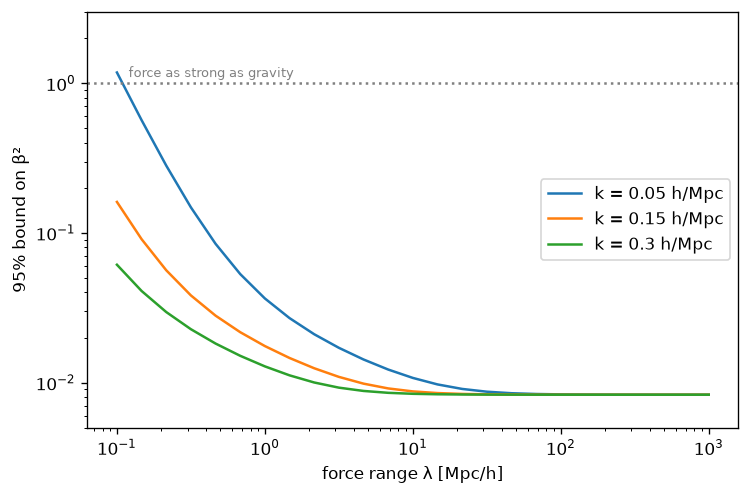
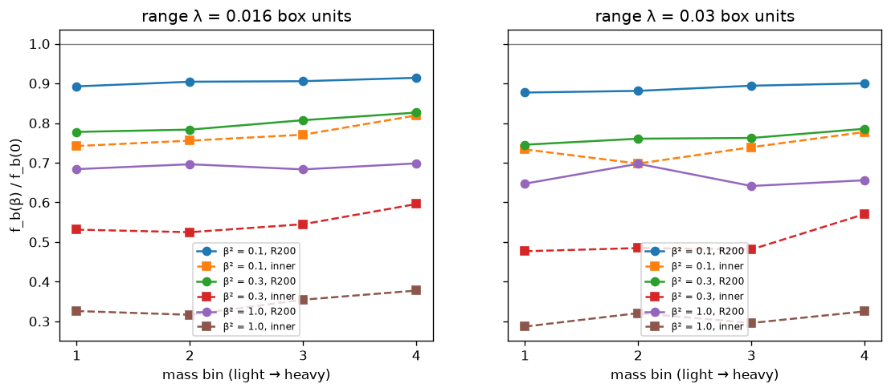

# skua

<!-- countdown:start -->
**Status:** complete, awaiting DESI DR3 (expected late 2026 / early 2027; nominal 2027-01-31): **92 days to go**.
<!-- countdown:end -->

A test rig for cosmological expansion histories, and what it says about the current evidence for
evolving dark energy. Successor to [janus-background-fits](../janus-background-fits), which ruled
out the Janus model; this repository asks the open question that followed: *where, if anywhere, do
the late-universe data lean away from ΛCDM, and how robust is that lean?*

Two instruments, calibrated against each other:

1. **A fast compressed rig** (`test_model.py`): any background model is a five-line file defining
   $E(z)$; it is fitted to cosmic chronometers, DESI DR2 BAO, a supernova sample (Pantheon+ or
   DES-Dovekie), optionally a compressed Planck likelihood ($R$, $\ell_A$, $\omega_b$) and the
   Gold-2018 $f\sigma_8$ compilation. Minutes per model.
2. **The full pipeline** (`yaml/`): the same question through `cobaya` + CAMB with the Planck 2018
   low-ℓ, high-ℓ (lite) and lensing likelihoods, the full DESI DR2 BAO likelihood with covariances,
   and the DES-SN5YR, DES-Dovekie or Pantheon+ supernova likelihoods. The machinery DESI uses.

## Validation

Every component reproduces a published number before it is used:

| component | this pipeline | published |
|---|---|---|
| compressed rig, flat ΛCDM, CC + BAO + Pantheon+ | H0 = 68.1, Ω_m = 0.304, r_d = 148.3 (free) | DESI DR2 BAO: Ω_m ≈ 0.297, h r_d ≈ 101.5 |
| compressed CMB at Planck best fit | r_s(z*) = 144.1, D_M(z*) = 13868 Mpc, R = 1.7496 | 144.4, 13870, 1.7502 |
| compressed rig + CMB, flat ΛCDM | H0 = 68.6, Ω_m = 0.304, r_d = 146.9 | Planck + BAO: ≈ 67.7, 0.31, 147.1 |
| growth, flat ΛCDM, Gold 2018 | χ² = 13.3 / 22 pts, σ8 = 0.76 at Ω_m = 0.30 | the usual mild S8 tension |
| full pipeline, flat ΛCDM, Planck + DESI DR2 + DES-SN5YR | H0 = 68.2, Ω_m = 0.304, r_d = 147.5, σ8 = 0.807 | DESI DR2 II: ≈ 68.0, 0.30, 147.5 |
| Dovekie covariance round-trip | ΛCDM SN χ² = 1635.1 (cobaya) vs 1634.4 (own code) | — |

## Results

### Background sweep without the CMB (`results/sweep.md`)

Ten model families fitted to CC + BAO + Pantheon+ (no CMB), ranked by AIC. Everything with
a Λ-like component lands within ΔAIC ≈ 3 of ΛCDM; DGP is out (+9.7); the no-dark-energy family
(matter + curvature, which contains Janus and Milne) is out by +319. The one lean: every model
that lets $w$ move finds $w_0 \approx -0.91$ with $w_a < 0$, at ≈ 2σ in each supernova sample.

### With the compressed CMB

| model (DES-Dovekie) | Δχ² vs ΛCDM | extra params | best fit |
|---|---|---|---|
| constant $w$ | −1.3 | 1 | $w = -0.97$ |
| decaying DM → Λ | −0.2 | 1 | ξ ≈ 0 |
| quintessence ($w \ge -1$ enforced) | −2.5 | 2 | sits on the $w = -1$ boundary |
| free spline in $\rho_{DE}(z)$ | −8.5 | 3 | $\rho_{DE}$ 9% higher at $z = 0.5$, lower before |
| CPL $w_0 + w_a(1-a)$ | **−9.3** | 2 | $(-0.83, -0.60)$ |
| interacting, $Q \propto \rho_{DE}$ | = wCDM | 2 | exactly degenerate with wCDM in the background |
| interacting, $Q \propto \rho_{DM}$ | −7.0 | 2 | $w = -0.94$, ξ = −0.004: a 3% early/late matter shift, no crossing |

The signal is present in BAO + CMB alone (Δχ² = −6.2 without any supernovae), it is in the
*evolution* of $w$ (a constant $w$ buys nothing), and it requires an effective crossing of
$w = -1$ around $z \approx 0.5$: forbidding the crossing removes ~7 of the 9 units. A single
minimally coupled scalar field cannot produce it. Growth data at Gold-2018 precision do not
distinguish the readings (all models give growth χ² ≈ 13.4).

### Full likelihood (cobaya + CAMB) and the calibration

| data | compressed rig | full likelihood | published (DESI DR2 II; DES-Dovekie) |
|---|---|---|---|
| BAO + CMB + Pantheon+ | −6.4, $(-0.86, -0.48)$ | **−8.3**, $(-0.81, -0.71)$ | 2.8σ, $(-0.84, -0.62)$ |
| BAO + CMB + DES-SN5YR (2024 release) | — | **−19.9**, $(-0.76, -0.84)$ | −21, 4.2σ, $(-0.75, -0.86)$ |
| BAO + CMB + DES-Dovekie (2025 recalibration) | −9.3, $(-0.83, -0.60)$ | **−12.4**, $(-0.81, -0.66)$ | ≈ −11, 3.2σ |

Δχ² is w₀wₐCDM minus ΛCDM at the best fit, two extra parameters. Best fits from `cobaya`'s
minimizer; run-to-run spread ≈ 1–2 units.

### Mundane explanations first (`results/calib_test_z0.1.txt`, `chains/ext.log`)

Before building any model on the signal, the two explanations that need no new physics.

**A low-redshift supernova calibration offset.** One free magnitude offset Δ for supernovae
below $z = 0.1$ (where the nearby calibration samples hand over to the surveys), profiled
analytically together with the absolute magnitude; CC + BAO + compressed CMB + supernovae:

| sample | CPL − ΛCDM, no offset | with Δ free | surviving | Δ wanted by ΛCDM | Δ wanted by CPL |
|---|---|---|---|---|---|
| DES-Dovekie (201 SNe below 0.1) | −9.3 | **−2.4** | 25% | +0.034 mag | +0.019 mag |
| Pantheon+ (630 SNe below 0.1) | −6.4 | **−4.3** | 67% | +0.016 mag | −0.008 mag |

On Dovekie, ΛCDM gains 7.7 units from a 0.034 mag offset alone — the size Efstathiou (2024)
identified between the two compilations at $z < 0.1$ — and three quarters of the evolving-DE
evidence is degenerate with it. On Pantheon+ the offset wanted is half as large and two thirds
of a weaker signal survives, at ≈ 2σ.

**Standard one-parameter extensions of ΛCDM** (full likelihood, Planck + DESI DR2 + Dovekie;
ΛCDM χ² = 2662.3, w₀wₐ = 2649.9):

| extension | Δχ² vs ΛCDM | best fit |
|---|---|---|
| Σmν free | −3.6 | Σmν → 0 (the known preference for a mass below the oscillation minimum) |
| Ω_k free | −2.9 | Ω_k = +0.002 |
| N_eff free | +0.5 | N_eff = 2.94 |
| w₀wₐ | −12.4 | (−0.81, −0.66) |

None substitutes for evolving dark energy: the signal is specifically about the late-time
expansion, which is consistent with both readings — dark energy, or the supernovae that
measure it.

## Conclusions

1. **The DESI DR2 evolving-dark-energy result reproduces.** With the full likelihoods this
   pipeline gives Δχ² = −19.9 for Planck + DESI DR2 + DES-SN5YR and −8.3 with Pantheon+, against
   the published −21 (4.2σ) and 2.8σ, with best-fit $(w_0, w_a)$ matching to ~0.05.
2. **The compressed rig is a reliable guide.** On matched data it tracks the full likelihood to
   within ≈ 2–3 units of Δχ² (always on the low side: the distance-prior CMB understates the signal modestly, as expected).
3. **The single largest effect in the question is the DES supernova calibration.** The 2025
   Dovekie recalibration leaves the best fit almost unchanged, $(w_0, w_a) \approx (-0.76, -0.9)$,
   but reduces the evidence from Δχ² ≈ −20 to ≈ −12 with everything else identical. The
   signal's location is stable; its strength depends on how ~1,800 supernovae were calibrated.
4. **Where the signal lives.** It is in BAO + CMB alone at ≈ 2.5σ; supernovae pin its amplitude.
   It is a preference for evolution with an effective phantom crossing near $z \approx 0.5$, which
   excludes thawing quintessence and the simplest interacting models, and leaves: a genuinely
   crossing effective equation of state (multi-field or non-minimally coupled), an interacting
   dark sector with evolving $w$, or an unresolved tension between datasets.
5. **The simplest adequate explanation is a calibration offset.** Allowing one free
   low-redshift magnitude offset of 0.02–0.03 mag — within the range of known survey-to-survey
   systematics and equal to the Pantheon+/DES discrepancy already reported — removes three
   quarters of the DES evidence and a third of the Pantheon+ evidence, leaving ≈ 2σ in each.
   No standard one-parameter extension of ΛCDM (Σmν, N_eff, Ω_k) absorbs the signal instead.
   By Occam's razor the current preference for evolving dark energy is adequately explained by
   supernova calibration plus a ≈ 2σ residual from BAO + CMB; it is not yet a foundation for
   model-building.
6. **Status.** The evidence is 2.5–3.3σ depending on catalogue and statistic, and the field is
   split between a frequentist "3σ and growing" reading and a Bayesian "no evidence once the extra
   parameters are penalised and Dovekie is used" reading. Nothing in this repository settles that;
   it reproduces both sides' numbers with one instrument. DESI DR3 and a unified supernova
   compilation are the data that will.

## Dark-sector fifth force (`growth_force.py`, `growth_force_range.py`)

The structure mechanism that survived the Janus tests — a second population whose own dynamics
shape ordinary matter — placed in a framework the data accept: ΛCDM background, positive masses,
and one new ingredient, an attractive Yukawa force between dark-matter particles of strength
$\beta^2$ relative to gravity and physical range $\lambda$; baryons feel gravity only.

Linear two-fluid growth against the Gold-2018 $f\sigma_8$ compilation, ΛCDM background fixed at
the Planck + DESI + SN best fit:

| regime | 95% bound on $\beta^2$ | why |
|---|---|---|
| $\sigma_8$ marginalised (shape only), any range | < 0.33 | the growth *shape* barely constrains it |
| CMB-normalised amplitude, $\lambda \gtrsim 10$ Mpc/h | **< 0.0083** | extra growth raises $\sigma_8$, which the data already want below Planck |
| CMB-normalised, $\lambda = 1$ Mpc/h | < 0.013–0.037 | a fixed physical range is a large comoving range at high $z$ |
| CMB-normalised, $\lambda = 0.1$ Mpc/h | 0.06 – > 1 (scale dependent) | linear modes no longer feel it |

A long-range dark force is limited to < 1% of gravity (consistent with Planck + BOSS bounds in
the literature). Below ≈ 100 kpc/h the linear data lose their grip entirely: a halo-scale force
comparable to gravity is allowed. That is the regime of the N-body phase below.

### N-body phase: what a galaxy-scale force does to halos (`halo_baryon_fraction.py`, `fifth_force_map.py`)

The force was implemented in the companion PM code (A18: DM–DM Yukawa kernel, both species positive,
baryons feel gravity only) and validated against linear two-fluid theory with no free parameters:
growth rates of both species to ~2% over a 50-fold expansion, and the DM/baryon split to 2% through the
linear regime. Production: 400k baryon + 2.08M dark-matter particles (equal particle masses — unequal
masses produce a spurious 5–8% baryon depletion by two-body segregation, confirmed and removed), 256³
PM grid, EdS expansion from a = 1/50, same seed for every run, cold species. Halos by friends-of-friends
on dark matter, R₂₀₀ on total mass; ≈ 730–800 halos with ≥ 200 particles per run; the baseline gives
f_b/f_cosmic = 0.99–1.01 in every mass bin.

| β² | f_b(β)/f_b(0) at R₂₀₀ | inside R₂₀₀/3 |
|---|---|---|
| 0.1 | 0.88 – 0.91 | 0.70 – 0.82 |
| 0.3 | 0.75 – 0.83 | 0.48 – 0.60 |
| 1.0 | 0.64 – 0.70 | 0.29 – 0.38 |

Ranges from four mass bins spanning a factor 50 and two force ranges (λ ≈ 2 and 4 R₂₀₀); the result
is nearly independent of both once the force spans the halo. Scale-free: 1 code mass ≈ 1.3 × 10¹²
M☉/h for a 10 Mpc/h box, i.e. these are galaxy-scale halos.

**What it means.** In the only window the linear data leave open (λ ≲ 100 kpc), the halos a strong
dark force would affect are galaxy halos, whose observed baryon fractions are set by feedback at the
factor-of-several level — a 10–30% force-driven depletion cannot be isolated there. Where baryon
fractions are a clean observable (clusters, f_gas to ~10%), the force would have to reach R₂₀₀ ≈ 1–2
Mpc, where the linear bound already limits β² to ≲ 0.01 and the depletion to ~1%. A short-range force
acting *inside* clusters (λ ≪ R₂₀₀) is the one case left, and it needs a dynamic range beyond a PM code
on one GPU. The observables that could test a galaxy-scale dark force are halo structure — concentrations,
satellite kinematics, gas–dark-matter offsets — not baryon budgets.

**Related work.** None of the physics here is new; the value is an independent, validated re-derivation.
Long-range dark forces in cosmology: Gradwohl & Frieman (1992). N-body with a scalar-mediated dark-matter
force and the resulting baryon/dark-matter segregation: Nusser, Gubser & Peebles (2005) PRD 71, 083505;
Keselman, Nusser & Peebles (2010) PRD 81, 063521. Yukawa-type dark forces in simulations: Hellwing &
Juszkiewicz (2009) PRD 80, 083522. Halo baryon fractions in coupled dark energy: Baldi et al. (2010)
MNRAS 403, 1684. Linear-cosmology bounds: Archidiacono, Castorina, Redigolo & Salvioni (2022) JCAP 10, 074.

## What the data require of any model (`notes/requirements.md`)

Decelerating expansion at $z > 0.7$ and gentle acceleration since; $r_d \approx 147$ Mpc with
$H_0 \approx 67$–68 from BAO + CMB; ≈ 0.95 of positively gravitating energy beyond baryons that
acts like matter early and like Λ late (no negative-density sector of any equation of state
substitutes for it); a matter era reaching $z > 15$; $f\sigma_8$ close to ΛCDM with σ8 ≈ 0.8;
and, if the DESI lean is physical, an effective $w$ that crosses −1 near $z \approx 0.5$.

## Reproducing

    pip install numpy scipy matplotlib emcee cobaya camb getdist
    ln -s ../janus-fits/data data                      # Pantheon+, DES-Dovekie files from the janus-fits setup
    python run_all.py                                  # background sweep, no CMB
    python test_model.py cpl des cmb growth            # any model, any data combination
    cobaya-install yaml/lcdm.yaml -p ~/cobaya_packages # Planck, DESI, DES, Pantheon+ data (~1 GB)
    cobaya-run yaml/w0wa.yaml -p ~/cobaya_packages     # full-likelihood best fit
    cobaya-run yaml/w0wa_dovekie.yaml -p ~/cobaya_packages

`models/` holds the background families; `yaml/` the cobaya runs (`lcdm`, `w0wa`, each with
`_pp` for Pantheon+ and `_dovekie` for the recalibrated DES sample). Dovekie is run through
cobaya's `sn.desy5` class with a converted dataset (`DESDovekie/`, see `notes/dovekie.md`).

## Sources

- DESI Collaboration, Abdul Karim M. et al. (2025), DR2 Results II, Phys. Rev. D 112, 083515 (arXiv:2503.14738).
- Planck Collaboration (2020), 2018 results VI; likelihoods via cobaya (Torrado & Lewis 2021).
- Lewis A., Challinor A., Lasenby A. (2000), CAMB.
- Scolnic D. et al. (2022) ApJ 938, 113 (Pantheon+); DES Collaboration (2024) ApJL 973, L14 (DES-SN5YR);
  Popovic B. et al. (2025/26), DES-Dovekie recalibration.
- Sagredo B., Nesseris S., Sapone D. (2018) PRD 98, 083543 (Gold fσ8 compilation).
- Chen L., Huang Q.-G., Wang K. (2019) JCAP 02, 028 (Planck 2018 distance priors).
- Aubourg É. et al. (2015) PRD 92, 123516 (r_d fitting formula).
- Moresco M. et al. (2012, 2016); Moresco M. (2015) (cosmic chronometers).
- Discussion of the evidence: arXiv:2511.10631 (Bayesian reading), arXiv:2508.10514 and
  arXiv:2609.10567 (parametrisation surveys), Efstathiou (2024/25).
